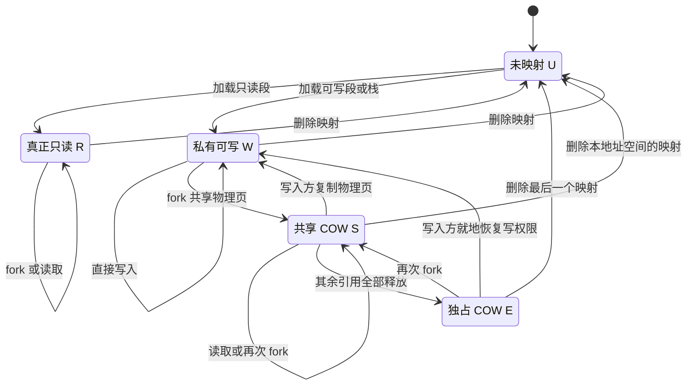

# Lab 5 写时复制设计报告

仓库原有的 `make qemu` 和 `make grade` 继续执行逐页直接复制。COW 实现位于 `code/cow_lab/`，由 `run_cow.py` 在临时副本中接入。实验内核的普通 `fork()` 仍为子进程创建独立地址空间。父子进程起初共享已经映射的物理页，首次写入仍被共享的可写页时，内核才为写入方分配副本。

`cow.c` 和 `cow.h` 实现共享映射、写缺页处理及内核回写。`integration.patch` 负责把实验模块接到临时内核的 `fork()`、写缺页和 `waitpid()` 路径，并给该副本的 TLB 刷新添加编译器内存屏障。测试结束后脚本会删除临时目录，原构建目录和源文件保持原样。

## 调用路径

| 操作 | 入口与处理 |
| --- | --- |
| 普通 `fork()` | `copy_mm()` 创建子进程页表，`dup_mmap()` 复制 VMA，`cow_copy_range()` 逐页建立共享映射。原来可写的条目在父子两边清除 `PTE_W` 并设置 `PTE_COW`。原来只读的条目沿用原权限，未映射的地址继续留空。 |
| 用户态写入 COW 页 | 写指令触发 RISC-V `CAUSE_STORE_PAGE_FAULT`。异常处理从 `tval` 取得地址并调用 `cow_handle_store_fault()`。处理成功后保留 `sepc`，由 CPU 重试原指令。 |
| 内核回写用户内存 | `do_wait()` 通过 `cow_copy_to_user()` 写入退出码。函数先验证整个目标范围，再逐页确认可写或解除 COW，然后写入字节。地址无效时返回失败，待回收的子进程仍可用合法地址再次 `waitpid()`。 |
| `exit()` 或 `exec()` 释放旧地址空间 | 最后一个 `mm_struct` 使用者离开时，`exit_mmap()` 删除该地址空间的映射。每删除一个叶 PTE，物理页引用减一，归零时释放物理页。 |
| `CLONE_VM` | 继续共享同一个 `mm_struct` 和页表，只增加 `mm_count`。对于已有 COW 条目，同一地址空间的线程看到同一次改映射。 |

`PTE_COW` 占用 Sv39 叶 PTE 的软件保留位 8。`VM_WRITE` 表示 VMA 允许的写权限，`PTE_W` 表示当前硬件页表项可写，`PTE_COW` 表示该只读条目可由 COW 路径恢复写权限。`page_ref()` 记录物理页引用，`mm_count()` 记录共享整个地址空间的进程数。

## 页级状态机

模型观察某个地址空间中的一个用户虚拟页。`ref` 是该条目当前指向的物理页的引用数。解除共享后，写入方和保留原页的一方各自按照自己的 PTE 与引用数判断状态。



| 状态 | 当前 PTE | 写入处理 |
| --- | --- | --- |
| U 未映射 | 缺少 PTE 或 `V=0` | 用户写触发 `-E_FAULT`，内核回写返回失败。 |
| R 真正只读 | `V=1, W=0, COW=0` | 禁止写入。共享映射时引用计数可以大于一。 |
| W 私有可写 | `V=1, W=1, COW=0` | CPU 正常写入。 |
| S 共享 COW | `V=1, W=0, COW=1, ref>1` | 检查当前 VMA 和 PTE，分配新页，复制 4 KiB，再替换写入方的映射。新页引用为一，原页引用减一。若原页仍有多方引用，留下的映射仍处于 S。 |
| E 独占 COW | `V=1, W=0, COW=1, ref=1` | 复用原物理页，清除 `COW` 并设置 `W`，引用数维持一。 |

共享页复制遇到内存不足时，当前页保留原映射和引用数，用户进程得到 `-E_NO_MEM` 退出状态。内核回写如果在准备多个目标页时失败，已解除 COW 的页仍是合法映射，目标数据尚未写入。普通 `fork()` 如果在建立子页表时失败，现有清理路径撤销子进程已建立的映射。已经降级的父页若变成独占 COW，下次写入即可就地恢复权限。

父页降级和缺页处理完成后都执行相应地址的 `sfence.vma`。父页降级时必须丢弃旧的可写 TLB 条目，否则 CPU 可能继续写共享物理页。当前内核使用单 hart 和 ASID 0，切换页表时沿用 `lsatp()` 的全量 TLB 刷新。

## Dirty COW 权限状态模拟

### Dirty COW 的成因与 Linux 修复机制

对于私有文件映射，写时复制应将修改限制在进程的私有页内。旧版 Linux 在处理一次写时复制后，清除了后续页面查找使用的 `FOLL_WRITE` 标志。此时调用方仍将执行写入，但重试路径已不再按写入要求选择目标页。如果私有页的映射在重试前被撤销，同一虚拟地址可能重新指向文件页缓存中的原始页。内核写入该页便会破坏私有映射应提供的写入隔离。

Linux 4.8.3 所含修复保留 `FOLL_WRITE` 以表明调用方的写入意图，并引入独立的 `FOLL_COW` 标志记录此前的 COW 处理结果。重试时，内核结合当前页表项的脏位检验该结果是否仍然有效。这样，即使虚拟地址相同，先前完成的 COW 也不能单独作为向当前物理页写入的依据。[Linux 4.8.3 修复说明](https://cdn.kernel.org/pub/linux/kernel/v4.x/ChangeLog-4.8.3)

### uCore 实验内核的权限检查

`fork()` 建立共享映射时，`cow_copy_range()` 在父、子进程的页表中清除原可写条目的 `PTE_W` 位，并设置 `PTE_COW` 位。原本只读的条目保留原权限。发生用户态写缺页时，`cow_handle_store_fault()` 首先检查当前虚拟内存区域（VMA）是否允许写入，再检查当前叶页表项（PTE）是否有效、允许用户读取且满足 `PTE_COW=1`、`PTE_W=0`。任一条件不满足时，处理函数返回 `-E_FAULT`。

检查通过后，若物理页引用数大于一，内核分配新页，将原页内容复制到新页，再替换写入方的映射。若引用数为一，则复用当前物理页。两条路径均设置写入方页表项的写权限并清除 COW 标志。`waitpid()` 经由 `cow_copy_to_user()` 向用户内存写入退出码时逐页检查目标范围，对需要解除 COW 的页调用同一处理函数。[uCore 实现](../code/cow_lab/cow.c)

实验内核运行于单 hart（单硬件线程）环境。用户异常入口关闭本地中断，`cow_copy_to_user()` 也在检查映射和写入数据期间关闭本地中断。因此，在上述路径中，当前进程可在发生进程切换前完成权限检查和映射更新。多 hart 环境还需要同步页表与物理页引用计数，并协调各 hart 的 TLB 失效操作。

### 错误版本的状态模型与抽象依据

Python 模型以 `previous` 和 `current` 表示同一虚拟地址在两次检查时的映射状态。每个状态包含 VMA 写权限和叶页表项类型。判定函数 `may_resolve_cow()` 仅在 VMA 允许写入且叶条目标记为 COW 时返回真。错误版本 `stale` 将 `previous` 传入该函数，修正版本 `fixed` 则传入 `current`。[权限模型源码](../code/cow_lab/permission_model.py)

模型检验的是历史权限判定在映射变化后是否仍然适用。对于这一问题，直接给定变化前后的状态，即可确定两种实现的返回值，具体的线程调度时序不影响比较结果。例如，先前允许解除 COW 的地址若已映射为普通只读页，依据历史状态仍会得到许可，依据当前页表项则应拒绝。映射撤销与只读页替换分别构成独立输入。模型的输出仅表示是否允许解除 COW，实际的页面复制与写入隔离由后文的内核测试检验。

下表以 VMA 可写且叶条目标记为 COW 作为共同的初始条件。

| 当前状态 | `stale` 错误版 | `fixed` 修复版 |
| --- | --- | --- |
| 仍为 COW 且 VMA 可写 | 允许解除 COW | 允许解除 COW |
| 普通只读页 | 错误地允许 | 拒绝 |
| 映射已删除 | 错误地允许 | 拒绝 |
| 仍为 COW 但 VMA 写权限已收回 | 错误地允许 | 拒绝 |
| 页表项已可写 | 错误地再次允许解除 COW | 无需解除 COW，可直接写入 |

## 测试

在项目根目录运行原有的直接复制程序与 Lab 5 回归评分。

```sh
make -C code qemu
make -C code grade
```

运行隔离的 COW 内核测试。脚本会选择 `cowtest`，并在 QEMU 返回后检查各阶段的通过标记。

```sh
python3 -B code/cow_lab/run_cow.py
```

用同一套测试比较权限模型。第一条命令预期以状态码 1 退出，第二条命令预期以状态码 0 退出。

```sh
python3 -B code/cow_lab/test_permissions.py stale
python3 -B code/cow_lab/test_permissions.py fixed
```

### 权限模型的对照测试

稳定映射用例令 `previous` 与 `current` 相同，遍历两种 VMA 写权限与四种叶页表项类型的全部八种组合。预期仅有 VMA 可写且叶条目为 COW 的组合返回真。两版均通过该用例，表明它们在映射稳定时均满足基本权限规则。

其余四个用例固定初始状态，分别将当前状态设为普通只读、映射撤销、VMA 写权限收回或页表项已可写。四项均预期返回假。前三项缺少授权解除 COW 所需的映射或权限，最后一项已具备直接写入条件。两版共用输入和断言，`stale` 在四个状态变化用例中均错误地返回真，`fixed` 通过全部五个用例。由于两版使用同一判定函数，结果差异可归因于选择了不同检查时刻的映射状态。[权限测试](../code/cow_lab/test_permissions.py)

### QEMU 内核测试的设计与判定依据

用户程序在 QEMU 中执行 `fork()`、用户态写入和 `waitpid()`。测试以不同进程读取的变量值、系统调用返回值及进程退出状态为观测量，分别检验写入隔离、只读保护和数据页共享。[内核测试程序](../code/cow_lab/tests/cowtest.c)

| 测试项 | 测试条件与预期结果 | 判定依据 |
| --- | --- | --- |
| 父子进程写入隔离 | 子进程确认全局变量和栈变量的初值分别为 5 和 11，再分别写入 7 和 13。父进程向全局变量写入 19，在子进程以状态 17 退出后，检查两个变量的值分别为 19 和 11。 | 子进程读到初值验证了 `fork()` 时的数据继承。父进程保留自己的全局变量值和原栈变量值，验证了两个位置的写入隔离。 |
| 内核回写隔离 | 初始进程将按页对齐的 `wait_status` 设为 `-1`。其子进程通过 `waitpid()` 将孙进程的退出码 23 写入该变量，随后以状态 29 退出。初始进程收到 29，确认自身的 `wait_status` 仍为 `-1`，再写入 31 并读回。 | 退出码 23 仅对接收方可见，验证了内核回写的隔离性。最后一次写入验证了其他引用释放后该页仍可写。 |
| 普通只读页保护 | 子进程向只读常量地址执行写指令。父进程以该地址作为 `waitpid()` 输出参数，预期返回 `-E_INVAL`。改用可写地址重试后，预期取得子进程的退出状态 `-E_FAULT`。 | 系统调用返回值检验内核回写的权限检查，子进程退出状态检验用户态写保护。重试成功还验证了首次回写失败后仍可回收子进程。 |
| 数据页共享 | 父进程在 5 MiB 数据区的每页写入标记 41，随后创建 32 个同时存活的子进程。子进程仅让出 CPU。父进程逐一终止并回收子进程后，检查首尾两页的标记。 | 在 `fork()` 时为每个子进程复制整个数据区，仅副本即需 160 MiB，超过实验配置的 128 MiB 物理内存。所有子进程均成功创建，为数据页共享提供了独立于写入隔离测试的证据。 |

上述断言覆盖单 hart 实验环境下的可观察行为。内核回写用例中，读回 31 能够验证独占映射的可写性。该用例没有记录物理页号，原页复用的实现依据是 `cow_handle_store_fault()` 中 `page_ref(page) == 1` 时直接重新映射原页的分支。

运行脚本要求 QEMU 正常退出，串口日志包含四组用例的通过标记、`cowtest pass.` 和 `init check memory pass.`，并检查日志中是否出现内核 panic。默认内核的 `exit` 用例和 `make grade` 用于原有逐页复制路径的回归验证，`exit` 用例以 `exit pass.` 和 `init check memory pass.` 为通过标记。[QEMU 测试脚本](../code/cow_lab/run_cow.py)

本机默认内核的 `exit` 用例正常完成，反汇编确认 `dup_mmap()` 调用原来的 `copy_range()`。直接复制版本的 `make grade` 得分 **130/130**，隔离 COW 内核打印 `cowtest pass.`，两版模型的结果与上表一致。

QEMU 4.1.1 需要显式选择 OpenSBI。本机验证通过命令行传入 `QEMU='qemu-system-riscv64 -bios default'`，评分时额外加入 `-icount shift=7,sleep=off` 加快模拟时钟。仓库原有的构建选项保持原样。
