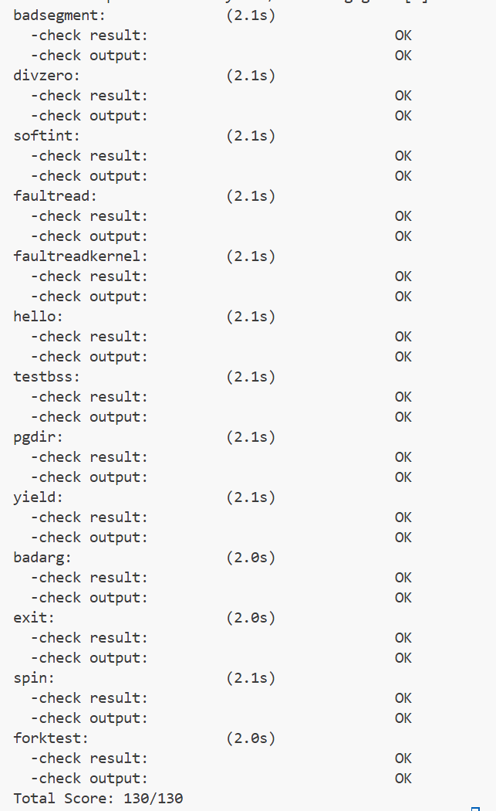
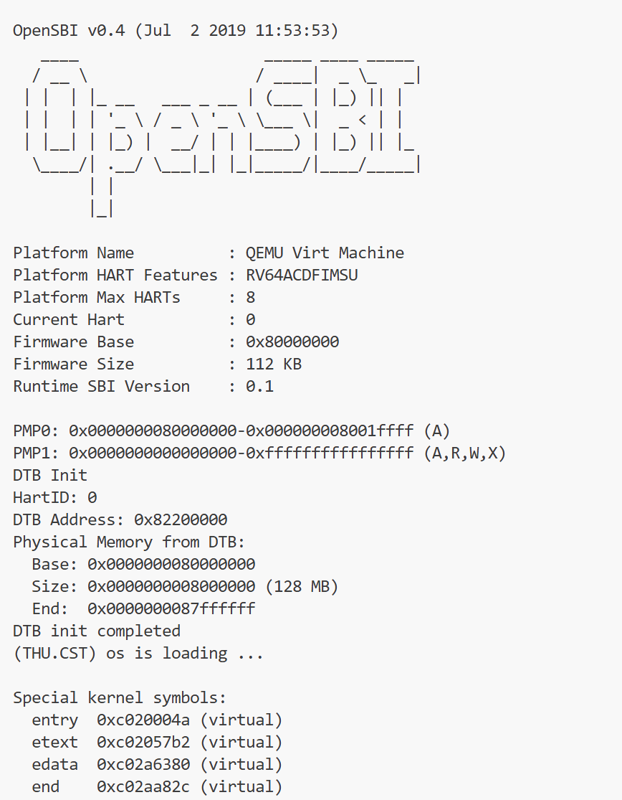
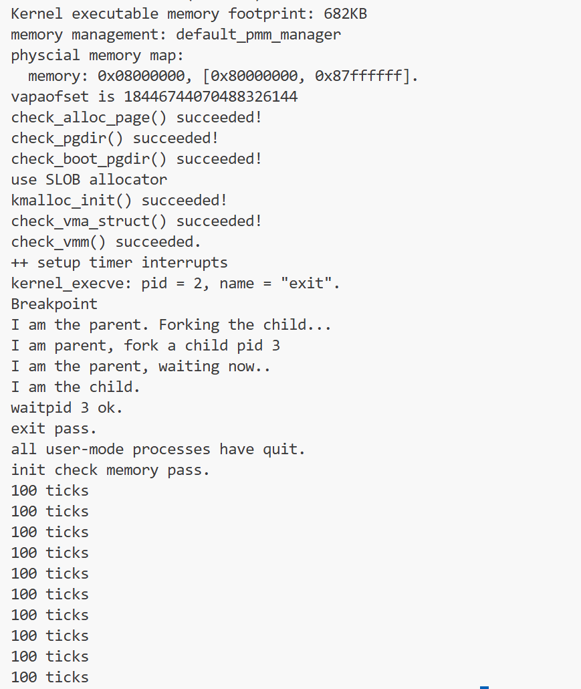

# 实验报告

## 实验基本信息

| 项目 | 内容 |
|------|------|
| **实验名称** | Lab 5: 用户程序 |
| **小组成员** | 2513628-乐嘉文、2511676-孙家昊、2510777-朱万旭 |
| **完成日期** | 待定 |

### 小组分工

| 成员 | 负责的练习/模块 | 负责的实验报告部分 |
|------|----------------|-----------|
| 2513628-乐嘉文 |分支任务：gdb 调试系统调用以及返回  | 实验目的、逻辑分析、内容实现、总结|
| 2511676-孙家昊 | 功能模块三、四、Challenge |  |
| 2510777-朱万旭 |功能模块一、二  | |

---

## 一、实验目的

- 了解第一个用户进程创建过程
- 了解系统调用框架的实现机制
- 了解ucore如何实现系统调用sys_fork/sys_exec/sys_exit/sys_wait来进行进程管理

---

## 二、实验环境

| 成员 | AI 编程工具 | 底层模型 | 备注 |
|------|------------|---------|------|
| 2513628-乐嘉文 | DeepSeek Harness | DeepSeek-V4.1-Flash | |
| 2511676-孙家昊 | Codex | GPT6.2-sol | |
| 2510777-朱万旭 | Deepseek Harness| Deepsee-V4.1-Flash | |

**说明：**
- **AI 编程工具**：指具体使用的终端工具、编辑器插件、桌面应用或浏览器界面
- **底层模型**：指该工具使用的大语言模型及版本

---

## 三、实验整体逻辑分析

### 2.1 本章节的逻辑主线

实验5开始构造用户进程，让用户程序真正运行在用户态，并在需要 ucore 支持时，通过系统调用进入内核获得服务。

### 2.2 功能的逐步实现

本实验需要完成系统调用入口、首个用户进程的创建与装载、用户进程的复制、以及退出、让出和终止等进程控制功能，从而把“启动内核线程”推进到“运行和管理用户程序”的完整阶段。

用户程序先通过系统调用进入内核，内核完成进程管理与虚拟内存管理后，再通过调度把结果送回用户态继续执行。

---

## 四、实验内容与实现

<!-- 
说明：本部分按照 exercises 文档中的练习顺序组织
每个功能模块或者练习中可能包含多项任务，请根据实际情况调整
-->

### 功能模块一：用户态系统调用功能

**负责人：** 2510777-朱万旭


#### 模块功能描述

用户程序通过 `ecall`把请求号和参数放入约定寄存器，`exception_handler` 识别出 `CAUSE_USER_ECALL` 后交给 `syscall`；`syscall` 从当前 `trapframe` 中取出调用号和参数并分发到各 sys_*，由它们完成进程管理、程序替换、等待回收、让出 CPU 等内核语义，最后把结果写回用户寄存器，经异常返回路径回到用户态。最终实现用户态系统调用功能。

**需要实现/修改的函数**

```c
kern/syscall/syscall.c
void syscall(void)
static int sys_exit(uint64_t arg[])
static int sys_fork(uint64_t arg[])
static int sys_wait(uint64_t arg[])
static int sys_exec(uint64_t arg[])
static int sys_yield(uint64_t arg[]) 
static int sys_kill(uint64_t arg[]) 
static int sys_getpid(uint64_t arg[]) 
static int sys_putc(uint64_t arg[])
static int sys_pgdir(uint64_t arg[])

kern/trap/trap.c
void exception_handler(struct trapframe *tf)
```

#### 最终提示词
本模块最终使用的提示词请见[模块一最终提示词.md](模块一最终提示词.md)
---

### 功能模块二：创建加载第一个用户进程功能

**负责人：** 2510777-朱万旭

#### 模块功能描述

本模块实现把系统从内核线程推进到第一个用户程序：`init_main` 创建 `user_main` 并等待其退出，`user_main` 通过 `kernel_execve` 把自身从内核线程转成用户进程；`kernel_execve` 经 ebreak 进入 trap 返回路径，之后由 `do_execve` 回收旧地址空间、`load_icode` 装载 ELF、建立用户页表和栈并配置 trapframe，最后由 sret 回到 U 模式，并由`do_wait` 进行回收。


**需要实现/修改的函数**

```c
kern/process/proc.c
static int init_main(void *arg)  
static struct proc_struct *alloc_proc(void)  
int kernel_thread(int (*fn)(void *), void *arg, uint32_t clone_flags)
int do_wait(int pid, int *code_store)  
static int user_main(void *arg)  
static int kernel_execve(const char *name, unsigned char *binary, size_t size)  
int do_execve(const char *name, size_t len, unsigned char *binary, size_t size)
static int load_icode(unsigned char *binary, size_t size)
```

#### 最终提示词
本模块最终使用的提示词请见[模块二最终提示词.md](模块二最终提示词.md)

---

### 功能模块三：复制用户进程功能

**负责人：** 2511676-孙家昊

#### 模块功能描述

用户进程通过 `sys_fork` 进入 `do_fork`。内核为子进程分配 PCB 和内核栈，准备独立的 `trapframe` 与调度上下文，并把子进程的返回寄存器 `a0` 置为 0。资源准备完成后，`do_fork` 在中断临界区分配 PID，将子进程登记到 PID 哈希表、全局进程链表和进程树，再将其设为可运行。父进程获得子进程 PID，子进程从原系统调用之后继续执行并获得返回值 0。

`copy_mm` 根据父进程的地址空间和 `CLONE_VM` 标志选择处理方式。父进程没有用户地址空间时，子进程沿用启动页表。设置了 `CLONE_VM` 时，子进程共享父进程的 `mm_struct`，并增加其引用计数。普通 `fork` 为子进程建立独立的地址空间，由 `dup_mmap` 复制各 VMA 的区间和属性，再由 `copy_range` 逐页复制已映射的用户页，在相同虚拟地址处建立权限一致的新映射。未映射的区域保留为空洞。复制失败时，各层回收已经分配的页面、页表和进程资源。

**需要实现/修改的函数**

```c
// kern/process/proc.c
int do_fork(uint32_t clone_flags, uintptr_t stack, struct trapframe *tf);
static int copy_mm(uint32_t clone_flags, struct proc_struct *proc);

// kern/mm/vmm.c
int dup_mmap(struct mm_struct *to, struct mm_struct *from);

// kern/mm/pmm.c
int copy_range(pde_t *to, pde_t *from, uintptr_t start, uintptr_t end, bool share);
```

#### 最终提示词

本模块最终使用的提示词请见[模块三最终提示词.md](模块三最终提示词.md)

---

### 功能模块四：其余系统调用功能

**负责人：** 2511676-孙家昊

#### 模块功能描述

`do_exit` 在入口检查当前进程，阻止 `idleproc` 和 `initproc` 退出。普通进程退出时，若持有用户地址空间，先切换到启动页表并减少 `mm` 引用计数，最后一个引用释放时回收用户映射、页表和 `mm_struct`。随后在中断临界区记录退出码，将当前进程置为 `PROC_ZOMBIE`，唤醒正在等待子进程的父进程，并把遗留的子进程交给 `initproc`。若移交了僵尸子进程，也会唤醒正在等待子进程的 `initproc`。退出进程随后交出 CPU，PCB 和内核栈由父进程调用 `do_wait` 回收。

`do_yield` 设置当前进程的 `need_resched`，由异常返回路径调用调度器处理。`do_kill` 按 PID 查找目标进程，并在中断临界区设置 `PF_EXITING`。目标正在进行可中断的睡眠等待时，内核将其唤醒。目标进程到达退出检查点后调用 `do_exit(-E_KILLED)`，继续沿用相同的退出与回收流程。

**需要实现/修改的函数**

```c
// kern/process/proc.c
int do_exit(int error_code);
int do_yield(void);
int do_kill(int pid);
```

#### 最终提示词

本模块最终使用的提示词请见[模块四最终提示词.md](模块四最终提示词.md)

---

### 扩展练习 Challenge

**负责人：** 2511676-孙家昊

#### Challenge1

写时复制（COW）的设计、实现与测试结果见 [Lab 5 写时复制设计报告](cow-design.md)。

#### Challenge2

**用户程序的预加载时机。** 构建 Lab 5 时，`Makefile` 先将用户程序编译、链接为 ELF 文件，再使用 `--format=binary` 将 ELF 文件的字节作为数据嵌入内核映像 `ucore.img`。QEMU 通过 `-kernel` 启动虚拟机时，将该映像加载到虚拟机的物理内存中。因此，用户程序的 ELF 数据在内核开始初始化和创建首个用户进程之前就已进入物理内存。

**用户地址空间的装载时机。** 内核启动后，`init_main()` 创建 `user_main` 内核线程。该线程根据链接器生成的符号取得所选 ELF 数据的起始地址和长度，调用 `kernel_execve()`，最终由 `load_icode()` 根据 ELF 程序头映射可加载段、分配物理页、复制代码和数据、清零 BSS，并建立用户栈和设置程序入口。这一步才将程序段装入该进程的用户虚拟地址空间。

**与通用操作系统的区别及原因。** 以 Linux 为例，用户程序通常以独立的可执行文件存放在文件系统中。执行 `execve()` 时，内核打开该文件，并将 ELF 可加载段映射到进程的虚拟地址空间。访问尚未映射到物理页的文件页时，内核可通过缺页处理从页缓存取得数据，必要时从文件读取。Lab 5 的装载函数直接接收内存中 ELF 数据的地址和长度。由于本阶段尚未实现从文件系统装载可执行文件的路径，将测试程序嵌入内核映像可以在启动后直接验证进程创建、地址空间建立和用户态切换。通用操作系统通过文件系统装载程序，则可独立于内核安装和更新应用，并按需装入文件页。
---
### 分支任务：gdb 调试系统调用以及返回

**负责人：** 2513628-乐嘉文

---

## 五、测试与验证

<!-- 根据该实验的具体情况，提供完整的测试运行截图，应包含：
- 编译及运行成功的输出（make qemu），可能有多个
- 测试通过的结果（make grade），只有一个
-->
# make grade:


# make qemu:


## 六、实验总结与收获

### 对操作系统的理解

了解到第一个用户进程创建的过程，系统调用框架的实现机制，以及ucore如何实现系统调用sys_fork/sys_exec/sys_exit/sys_wait来进行进程管理。

---

