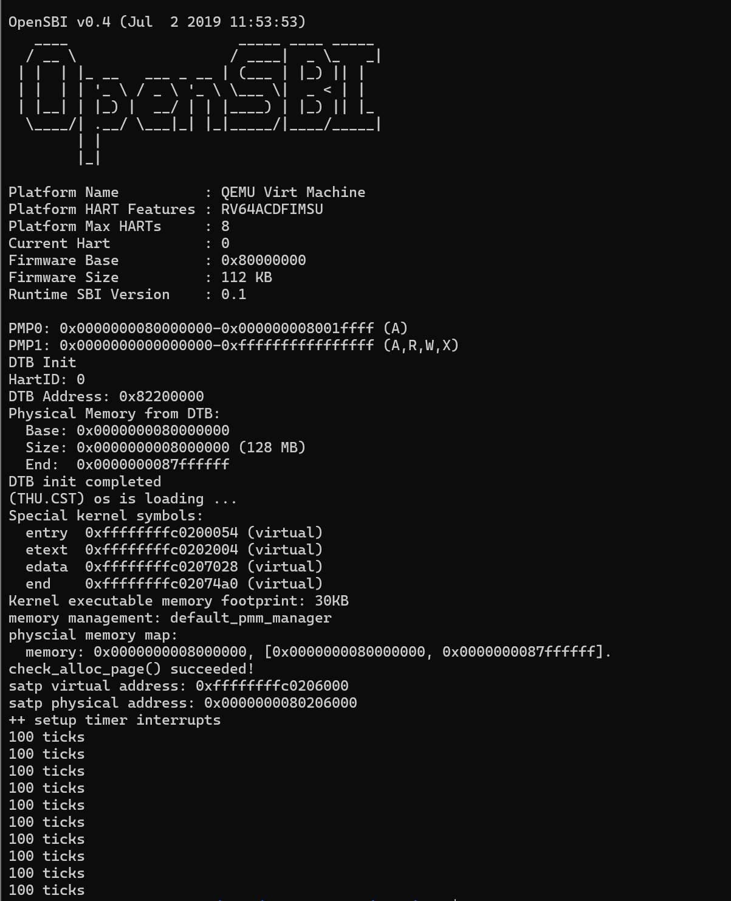
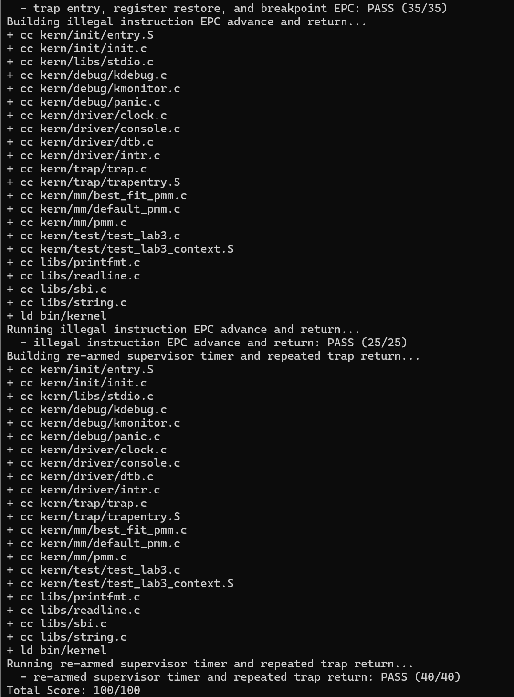

# 实验报告

## 实验基本信息

| 项目 | 内容 |
|------|------|
| **实验名称** | Lab 3: 断，都可以断 |
| **小组成员** | 2513628-乐嘉文、2511676-孙家昊、2510777-朱万旭 |
| **完成日期** | 11 月 5 日 |

### 小组分工

| 成员 | 负责的练习/模块 | 负责的实验报告部分 |
|------|----------------|-----------|
| 2513628-乐嘉文 | 文书工作 | 实验目的、整体逻辑分析、总结与收获|
| 2511676-孙家昊 | 中断与异常处理功能 | 功能模块二：中断与异常处理功能 |
| 2510777-朱万旭 |Trap 上下文恢复与 Trap 入口功能 | 功能模块一：Trap上下文恢复与Trap入口功能 |

---

## 一、实验目的

<!-- 说明本次实验的主要目标和预期成果 -->

本实验的主要目的是：

1. 理解中断处理机制
2. 学习中断前后如何进行上下文环境的保存与恢复

---

## 二、实验环境

<!-- | 成员 | AI 编程工具 | 底层模型 | 备注 |
|------|------------|---------|------|
| 学号1-姓名1 | [例如：Cline（VS Code插件） / Claude Code（终端 Agent） / DeepSeek Harness等] | [例如：Claude Sonnet 4.5 / GPT-5.5 / DeepSeek-V4-Flash等] | [可选：特殊配置等] |
| 学号2-姓名2 | | | |
| 学号3-姓名3 | | | | -->

| 成员 | AI 编程工具 | 底层模型 | 备注 |
|------|------------|---------|------|
| 2513628-乐嘉文 | DeepSeek Harness | DeepSeek-V4.1-Flash | |
| 2511676-孙家昊 | Codex | GPT6.1-sol | |
| 2510777-朱万旭 | Codex| GPT6.1-sol | |

**说明：**
- **AI 编程工具**：指具体使用的终端工具、编辑器插件、桌面应用或浏览器界面
- **底层模型**：指该工具使用的大语言模型及版本

---

## 三、实验整体逻辑分析

### 2.1 本章节的逻辑主线

<!-- [请用自己的话描述本章实验的核心主线，例如：
- 本章围绕哪个核心主题展开？（例如：用户进程管理、虚拟内存、文件系统等）
- 整个实验解决什么问题？（例如：如何让用户程序运行在操作系统之上）] -->

核心主题：中断处理机制
实验解决的问题：如何开启/关闭中断，如何正确处理中断。

### 2.2 功能的逐步实现

<!-- [说明本章实验是按照什么顺序逐步实现各个功能的，以及为什么要按这个顺序，例如：

1. 首先实现**功能A** → 为什么首先实现这个？（例如：建立系统调用接口是后续所有用户态功能的基础）
2. 接着再完善**功能B** → 为什么接着实现这个？（例如：有了系统调用后，需要能够加载和启动第一个用户进程）
3. 然后完成**功能C** → 为什么然后实现这个？（例如：有了第一个进程后，需要实现进程复制功能）
4. 最后补充了**功能D** → 为什么最后实现这个？（例如：最后完善进程退出和清理机制，形成完整闭环）] -->

1. 首先初始化 `sscratch` 和 `stvec` 寄存器，为正确跳转到中断处理程序作准备。
2. 然后初始化时钟（`clock_init()`），设置中断间隔时间，打开时钟中断。
3. 实现 `intr_enable()` 打开全局中断，自此中断初始化完毕。
4. 实现 `__alltraps` 和 `__trapret`，管理中断时的上下文，以便恢复用户态进程。
5. 实现 `trap_dispatch(struct trapframe *tf)` ，分类处理 trap。

---

## 四、实验内容与实现

<!-- 
说明：本部分按照 exercises 文档中的练习顺序组织
每个功能模块或者练习中可能包含多项任务，请根据实际情况调整
-->

### 功能模块一：Trap 上下文恢复与 Trap 入口功能

**负责人：** 朱万旭
#### 模块功能描述
本模块主要实现了trap从进入内核到返回原执行流之间的底层上下文管理。对于功能的描述主要分为两个部分：第一，对于RESTORE_ALL，完成了恢复功能，使得原程序的状态能够从trapframe结构体中恢复出来；第二，对于__alltraps，则为汇编trap入口与C函数trap()之间的调用关系，也就是能够让trapframe正确地传递给trap()函数进行进一步处理。

**需要实现/修改的部分：**
1.`RESTORE_ALL`(汇编宏)：按照trapframe的布局恢复各通用寄存器，如将status、epc分别写回sstatus、sepc,并在所有依赖trapframe基地址读取完成后再恢复sp，便于sret的进行。

2.`__alltraps`（trap汇编入口）：调用SAVE_ALL保存上下文，并通过a0寄存器保存sp指向的trapframe，再调用C函数trap()进行中断异常处理。函数返回后，进入__trapret，完成上下文恢复和trap返回。

#### 最终提示词
本模块使用的最终提示词请见[功能模块一prompt.md](功能模块一prompt.md)

**最终结果：**
1.成功通过编译

2.运行测试并通过

3.功能符合预期


<!-- #### 模块功能描述

**需要实现/修改的函数：**

```c
// 列出本模块涉及的所有函数签名
void example_function(void);
int another_function(int arg);
``` -->


<!-- #### 最终提示词

以下是经过迭代优化后，最终成功实现该功能的提示词：

````markdown

[按照提示词模板，给出具体的提示词]

````

#### 实现迭代过程

本模块的实现经历了 [N] 次迭代，过程如下：

---

##### 第一次迭代

如果设计的prompt生成代码后出现问题：

**遇到的问题：**
- 问题1：问题描述、错误信息和原因分析
- 问题2：问题描述、错误信息和原因分析

**问题解决策略：**
- 针对问题1：[说明如何修改提示词]
- 针对问题2：[说明如何修改提示词]

如果没有问题：

**最终结果：**

经过 [N] 次迭代，该模块最终：
- ✅ 编译通过
- ✅ 所有相关测试通过
- ✅ 功能符合预期

**关键改进点总结（如有）：**
1. [改进点1：例如，在 [RELY] 中补充了完整的系统调用号定义]
2. [改进点2：例如，在 [SPECIFICATION] 中明确了异常处理的边界条件]
3. [改进点3：例如，增加了对用户指针合法性检查的要求]

---

##### 第二次迭代（如有）

[按照和第一次迭代相同的格式]

---

##### 第三次迭代（如有）

[按照和第一次迭代相同的格式] -->

---

### 功能模块二：中断与异常处理功能

**负责人：** 孙家昊

#### 模块功能描述

本模块在已有 Trap 入口与上下文保存机制的基础上，完成中断和异常的分类处理，并通过 Trap frame 与后续的现场恢复流程衔接。中断处理负责持续响应时钟事件及输出诊断信息；异常处理负责报告异常位置，并为本实验支持的非法指令和断点异常调整返回地址。

**需要实现/修改的函数：**

```c
void interrupt_handler(struct trapframe *tf);
void exception_handler(struct trapframe *tf);
```

**主要功能：**

1. **中断分类与诊断：** 从 `tf->cause` 中去除最高位中断标志，按原因编号区分软件中断、时钟中断和外部中断，输出对应提示；遇到未知中断时输出原因编号，并调用 `print_trapframe(tf)` 打印完整现场，不修改保存的现场字段。
2. **持续时钟中断处理：** 收到 S 态时钟中断后，先调用 `clock_set_next_event()` 设置下一次时钟事件，再递增累计计数 `ticks`。每累计 100 次中断调用 `print_ticks()` 输出一行 `100 ticks`，使用函数内静态变量保存输出次数；正常构建下累计输出 10 次后调用 `sbi_shutdown()` 关机。
3. **非法指令与断点异常处理：** 先按 `Illegal instruction at 0x%016lx` 或 `Breakpoint at 0x%016lx` 的格式输出原始异常地址，再读取指令起始的 16 位半字判断长度。最低两位不为 `11` 时将 `tf->epc` 增加 2；最低两位为 `11` 且第 4～2 位不全为 `1` 时增加 4，从而覆盖 `c.ebreak`、`ebreak` 以及测试中的 4 字节非法指令。处理函数返回后，由已有汇编恢复现场并执行 `sret`。
4. **其他异常的现场输出：** 对访存异常、各类 ECALL 以及未知异常调用 `print_trapframe(tf)`，保持 `tf->epc` 不变，也不读取该地址的指令内容。本模块仅处理实验要求的 16 位和 32 位指令长度，不扩展到更长指令或其他异常恢复机制。

#### 最终提示词

本模块使用的最终提示词见 [prompt.md](prompt.md)。

## 五、测试与验证

<!-- 根据该实验的具体情况，提供完整的测试运行截图，应包含：
- 编译及运行成功的输出（make qemu），可能有多个
- 测试通过的结果（make grade），只有一个
-->


---

## 六、实验总结与收获

### 对操作系统的理解
<!-- 
1. 列出你们认为本实验中重要的知识点，以及与对应的 OS 原理中的知识点，并简要说明二者的含义、关系和差异
2. 列出你们认为 OS 原理中很重要、但在本实验中没有对应上的知识点 -->
重要的知识点：处理 trap 时需要保存和恢复寄存器，且需根据 trap 类型区别处理。
OS 原理中很重要、但在本实验中没有对应上的知识点：保存寄存器应该保存在内核栈上，但是本实验中却把寄存器保存在了用户栈上。


### AI 协作开发的经验

<!-- [写出你们在与 AI 协作过程中实际收获的经验或者感悟] -->

---

