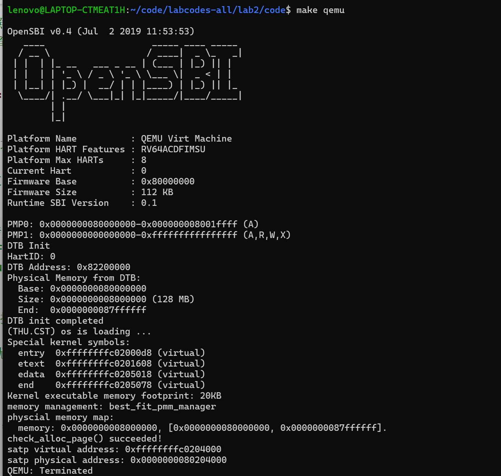
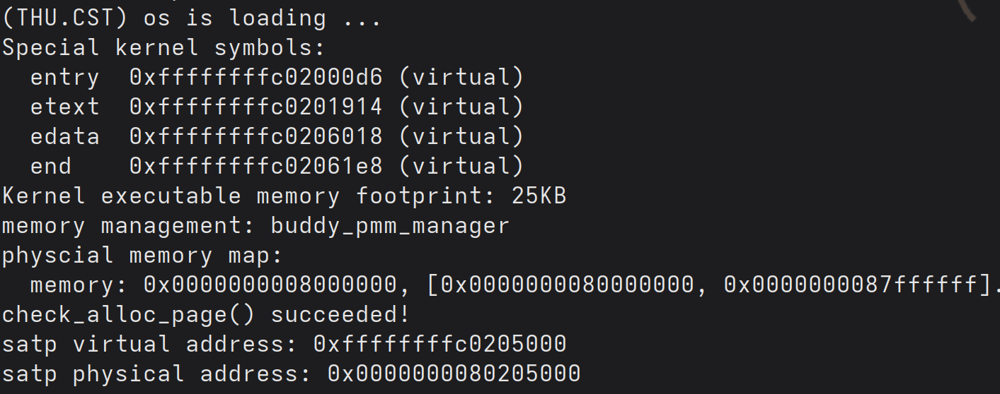

## 实验基本信息

| 项目 | 内容 |
|------|------|
| **实验名称** | Lab 2: 物理内存和页表 |
| **小组成员** | 2513628-乐嘉文、2511676-孙家昊、2510777-朱万旭 |
| **完成日期** | <font color=red>待定<font> |

### 小组分工

| 成员 | 负责的练习/模块 | 负责的实验报告部分 |
|------|----------------|-----------|
| 2513628-乐嘉文 | 实现物理内存探测与页描述符初始化功能、实现 buddy system（伙伴系统）分配算法 |实验目的、逻辑分析、总结 |
| 2511676-孙家昊 | 理解 first-fit 连续物理内存分配算法、实现 Best-Fit 连续物理内存分配算法 | 功能模块二任务一、任务二及 Best-Fit 测试与验证 |
| 2510777-朱万旭 | Challenge：硬件的可用物理内存范围的获取方法、Challenge：任意大小的内存单元 slub 分配算法 |  |

---

## 一、实验目的

<!-- 说明本次实验的主要目标和预期成果 -->

本实验的主要目的是：

1. 理解页表的建立和使用方法 
2. 理解物理内存的管理方法 
3. 理解页面分配算法 

---

## 二、实验环境

<!-- | 成员 | AI 编程工具 | 底层模型 | 备注 |
|------|------------|---------|------|
| 学号1-姓名1 | [例如：Cline（VS Code插件） / Claude Code（终端 Agent） / DeepSeek Harness等] | [例如：Claude Sonnet 4.5 / GPT-5.5 / DeepSeek-V4-Flash等] | [可选：特殊配置等] |
| 学号2-姓名2 | | | |
| 学号3-姓名3 | | | | -->

| 成员 | AI 编程工具 | 底层模型 | 备注 |
|------|------------|---------|------|
| 2513628-乐嘉文 | DeepSeek Harness | DeepSeek-V4.1-Flash | |
| 2511676-孙家昊 | Codex | GPT6.1-sol | |
| 2510777-朱万旭 | Codex| GPT6.1-sol | |

**说明：**
- **AI 编程工具**：指具体使用的终端工具、编辑器插件、桌面应用或浏览器界面
- **底层模型**：指该工具使用的大语言模型及版本

---

## 三、实验整体逻辑分析

### 2.1 本章节的逻辑主线

<!-- [请用自己的话描述本章实验的核心主线，例如：
- 本章围绕哪个核心主题展开？（例如：用户进程管理、虚拟内存、文件系统等）
- 整个实验解决什么问题？（例如：如何让用户程序运行在操作系统之上）] -->

核心主题：虚拟内存与内存管理
实验解决的问题：如何灵活、有效地管理物理内存

### 2.2 功能的逐步实现

<!-- [说明本章实验是按照什么顺序逐步实现各个功能的，以及为什么要按这个顺序，例如：

1. 首先实现**功能A** → 为什么首先实现这个？（例如：建立系统调用接口是后续所有用户态功能的基础）
2. 接着再完善**功能B** → 为什么接着实现这个？（例如：有了系统调用后，需要能够加载和启动第一个用户进程）
3. 然后完成**功能C** → 为什么然后实现这个？（例如：有了第一个进程后，需要实现进程复制功能）
4. 最后补充了**功能D** → 为什么最后实现这个？（例如：最后完善进程退出和清理机制，形成完整闭环）] -->

1. 首先实现**设备树的初始化**，从 `dtb(device tree blob)` 中解析出系统物理内存信息，为下一步分页和物理内存初始化打基础。
2. 然后实现 `pmm_manager` 和 页 的初始化，为下一步内存管理做准备。
3. 最后检查分配和释放物理内存的功能的正确性，保障功能正常运行。
---

## 四、实验内容与实现

<!-- 
说明：本部分按照 exercises 文档中的练习顺序组织
每个功能模块或者练习中可能包含多项任务，请根据实际情况调整
-->

### 功能模块一：物理内存初始化功能 


<!-- #### 模块功能描述

**需要实现/修改的函数：**

```c
// 列出本模块涉及的所有函数签名
void example_function(void);
int another_function(int arg);
``` -->

<!-- #### 最终提示词

以下是经过迭代优化后，最终成功实现该功能的提示词：

````markdown

[按照提示词模板，给出具体的提示词]

````

#### 实现迭代过程

本模块的实现经历了 [N] 次迭代，过程如下：

---

##### 第一次迭代

如果设计的prompt生成代码后出现问题：

**遇到的问题：**
- 问题1：问题描述、错误信息和原因分析
- 问题2：问题描述、错误信息和原因分析

**问题解决策略：**
- 针对问题1：[说明如何修改提示词]
- 针对问题2：[说明如何修改提示词]

如果没有问题：

**最终结果：**

经过 [N] 次迭代，该模块最终：
- ✅ 编译通过
- ✅ 所有相关测试通过
- ✅ 功能符合预期

**关键改进点总结（如有）：**
1. [改进点1：例如，在 [RELY] 中补充了完整的系统调用号定义]
2. [改进点2：例如，在 [SPECIFICATION] 中明确了异常处理的边界条件]
3. [改进点3：例如，增加了对用户指针合法性检查的要求]

---

##### 第二次迭代（如有）

[按照和第一次迭代相同的格式]

---

##### 第三次迭代（如有）

[按照和第一次迭代相同的格式] -->


#### 任务一：实现物理内存探测与页描述符初始化功能 
**负责人：**  乐嘉文

#### Challenge：硬件的可用物理内存范围的获取方法
**负责人：**  朱万旭


### 功能模块二：物理内存分配功能

#### 任务一：理解first-fit 连续物理内存分配算法
**负责人：**  孙家昊

##### First-Fit 的具体实现

结合 [First-Fit 原稿](./first_fit实验报告.md) 和 `code/kern/mm/default_pmm.c`，该分配器用 `free_list` 按物理地址从低到高连接空闲块。链表中只保存各块的首页，块头的 `property` 表示连续空闲页数，`PG_property` 标记它是空闲块头；`nr_free` 统计所有空闲页的总数。

1. **初始化管理状态：`default_init()`。** 初始化双向循环链表 `free_list`，并将 `nr_free` 置为 0。此时只是建立管理结构，尚未加入可分配的物理页。
2. **初始化空闲页：`default_init_memmap(base, n)`。** 检查这 `n` 页原来均为保留页，逐页清除旧标志和 `property`，将引用计数置为 0。然后设置 `base->property = n` 和块头标志，将首页按地址顺序插入空闲链表，空闲页总数增加 `n`。
3. **分配连续页：`default_alloc_pages(n)`。** 从链表头开始，找到第一个 `property >= n` 的空闲块。若块大小为 `x`，则取出前 `n` 页；当 `x > n` 时，以 `page + n` 为剩余块首页，记录 `x - n` 页并放回原链表位置。最后清除已分配块的块头标志，将 `nr_free` 减去 `n`，返回分配块首页。若总空闲页不足，或没有足够大的连续块，则返回 `NULL`。
4. **回收与合并：`default_free_pages(base, n)`。** 检查待释放页不是保留页或空闲块头，重置页标志与引用计数，设置新的块头和长度，按地址插回链表，`nr_free` 增加 `n`。若前块满足 `prev + prev->property == base`，先向前合并，再用合并后的块头检查后块是否连续；连续则继续合并。合并时更新长度，移除多余链表节点并清除旧块头标志，空闲页总数不再重复增加。

`default_nr_free_pages()` 直接返回 `nr_free`。整个过程始终以页为单位，只有物理地址连续的空闲块才能合并。

##### 原有 First-Fit 算法的改进空间

1. **提高查找效率。** 当前分配和释放时寻找插入位置都可能遍历整个空闲链表，设空闲块数为 `k`，最坏需要 `O(k)` 时间。可以增加辅助索引或采用分级空闲链表减少扫描。Next-Fit 从上次查找位置继续扫描，也能减少部分重复扫描，但改变了选择策略，且不能保证碎片更少；分级链表的操作也不能一概视为 `O(1)`。
2. **权衡碎片与管理开销。** 当前实现已经在释放时合并相邻块，应保留这一机制。若引入分裂阈值，把很小的余块一起分配出去，就需要额外记录实际分配页数，确保回收与统计一致，并接受内部碎片。延迟合并可降低部分释放开销，但会推迟连续大块的形成，不能直接认为它能减少碎片。

#### 任务二：实现 Best-Fit 连续物理内存分配算法
**负责人：**  孙家昊

##### 最终提示词

本任务使用的完整提示词见 [best_fit_prompt.md](./best_fit_prompt.md)。提示词明确了管理器接口、测试对内部状态的约定、分配与释放规则，以及启用 Best-Fit 和验收的方法。


##### Best-Fit 算法的改进空间

Best Fit 算法仍有改进空间。当前实现需要遍历空闲链表寻找最小合适块，当空闲块较多时，分配效率较低，可通过平衡树或按大小分桶加快查找。此外，Best Fit 容易产生较小的剩余空闲块，造成外部碎片；释放时合并相邻空闲块可以缓解这一问题。还可以增加页面分配状态检查，避免重复释放导致空闲链表和页数统计出错。

#### 任务三：buddy system（伙伴系统）分配算法
**负责人：**  乐嘉文
见 [详细版报告](./buddy_system设计文档/详细版.md) 和 [精简版报告](./buddy_system设计文档/精简版.md)

#### Challenge：任意大小的内存单元 slub 分配算法
**负责人：**  朱万旭

---

## 五、测试与验证

<!-- 根据该实验的具体情况，提供完整的测试运行截图，应包含：
- 编译及运行成功的输出（make qemu），可能有多个
- 测试通过的结果（make grade），只有一个
-->
### Best-Fit 分配算法测试


在 `code/` 目录下使用 `make qemu` 启动内核。根据已有运行截图，关键输出为：

```text
memory management: best_fit_pmm_manager
check_alloc_page() succeeded!
```

第一行表明当前启用的是 Best-Fit 管理器；第二行在 `pmm_manager->check()` 返回后输出，说明其调用的 `best_fit_check()`（包含 `basic_check()`）已通过。检查覆盖基本页分配与释放、空链表分配失败、连续块不足时返回 `NULL`、优先选择最小合适块，以及回收后的空闲页数和链表状态恢复。



### buddy system 分配算法测试:



## 六、实验总结与收获

### 对操作系统的理解
<!-- 
1. 列出你们认为本实验中重要的知识点，以及与对应的 OS 原理中的知识点，并简要说明二者的含义、关系和差异
2. 列出你们认为 OS 原理中很重要、但在本实验中没有对应上的知识点 -->
1. 虚拟内存的必要性、物理内存的管理、分页机制、页面分配算法。其是 OS 原理中的简化版本，但本质思想是一致的。
2. 其他分配算法

### AI 协作开发的经验

<!-- [写出你们在与 AI 协作过程中实际收获的经验或者感悟] -->

---

